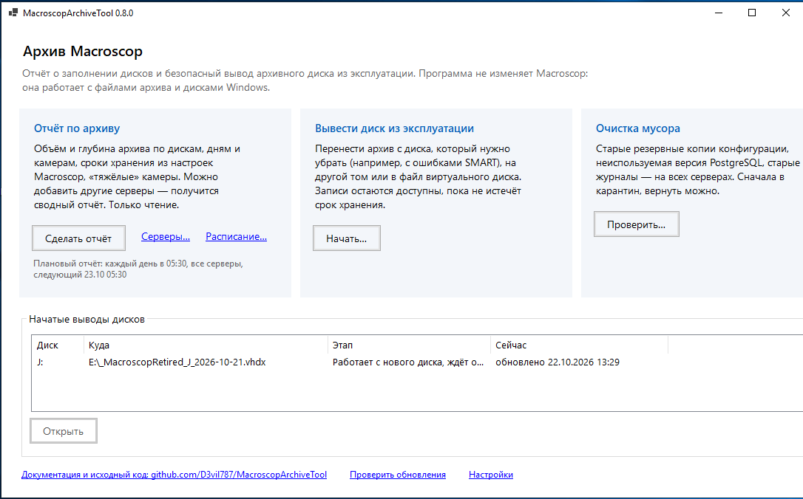
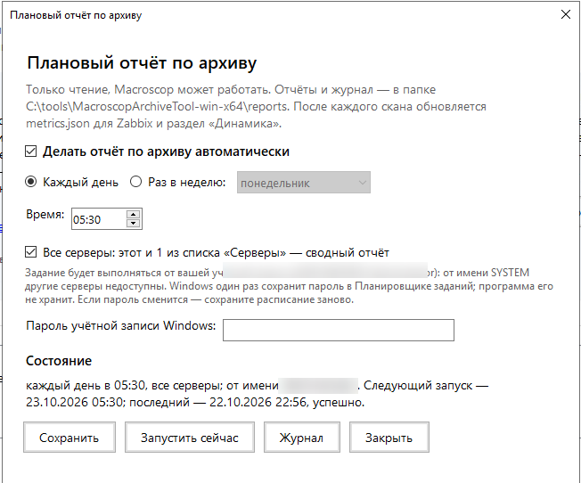
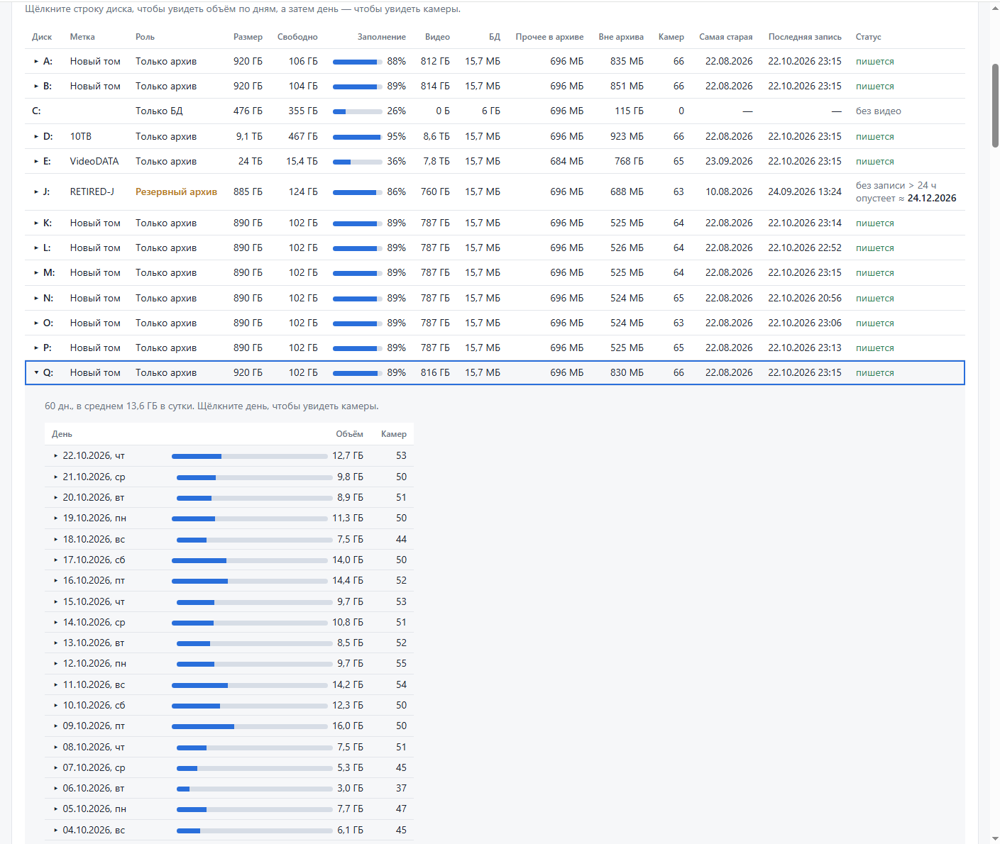
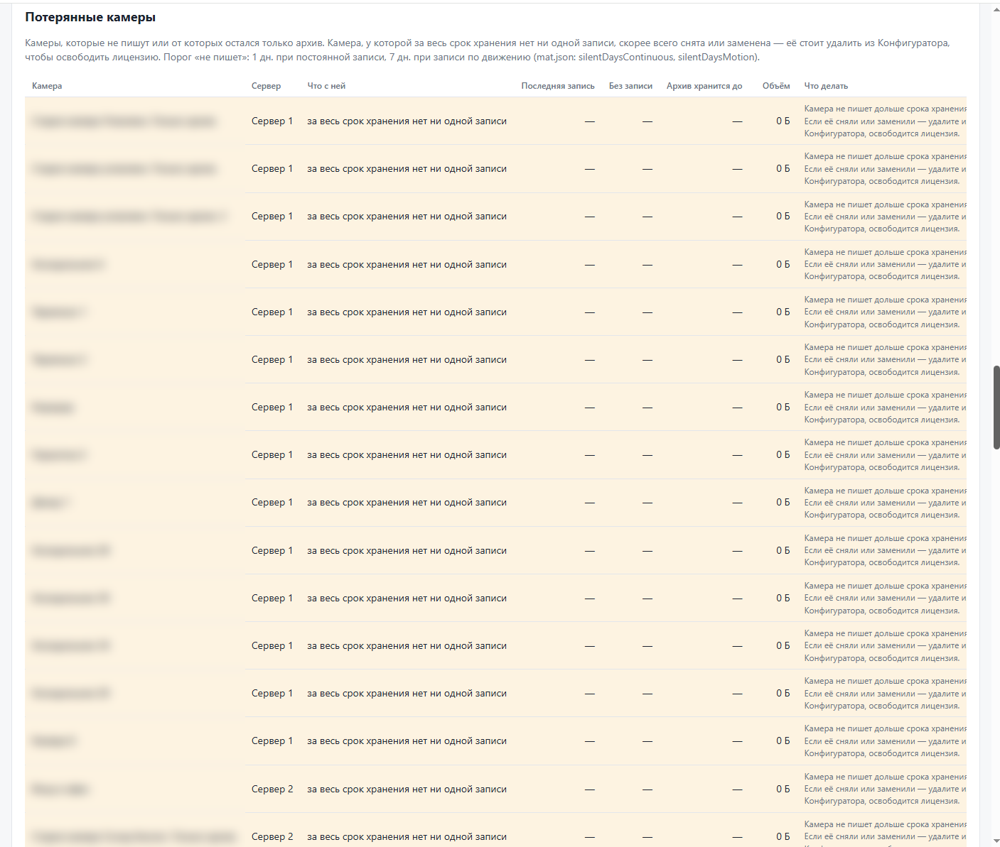
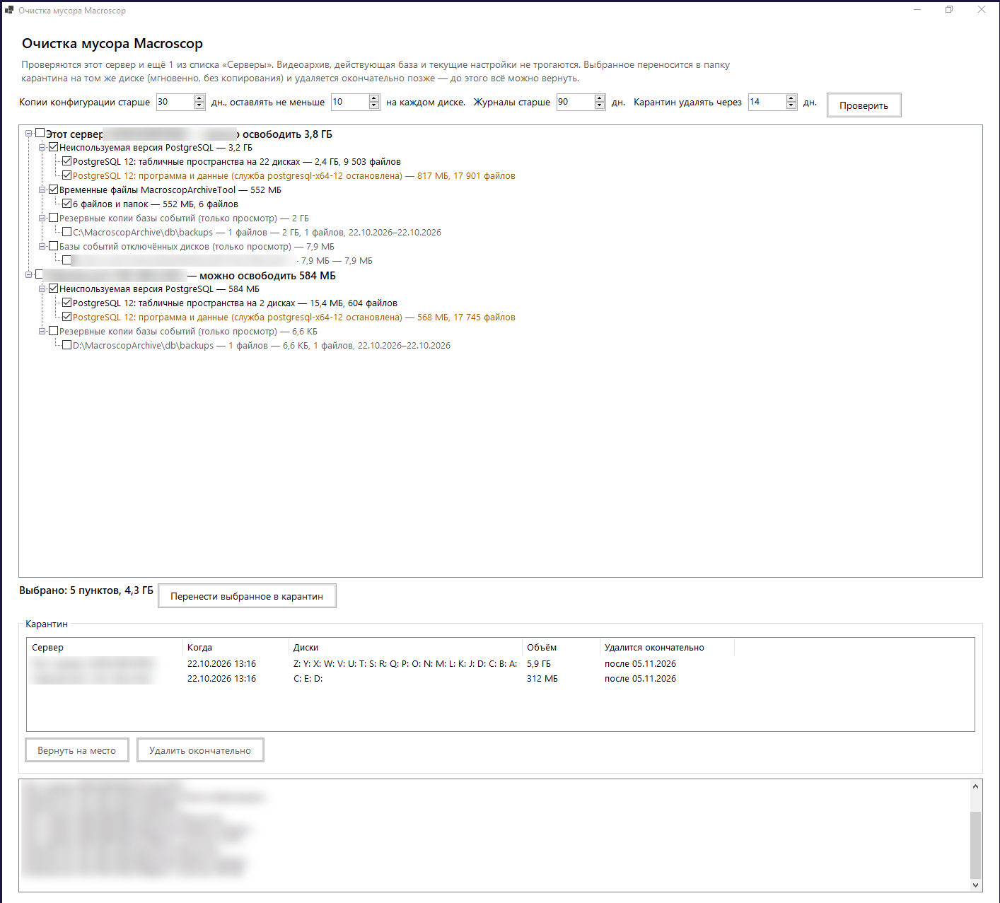

# MacroscopArchiveTool

> **English summary.** Free, open-source (MIT) companion tool for the archive of **Macroscop 4.7** video management
> software on Windows Server. It reports archive usage per disk, day and camera (including several servers in one report),
> reads per-camera retention from Macroscop configuration backups, and safely retires a failing archive disk by moving
> its archive into another volume or a VHDX file with verified, resumable copying and rollback.
> It never modifies Macroscop binaries or databases. Downloads: [GitHub Releases](https://github.com/D3vil787/MacroscopArchiveTool/releases).
> Code signing policy: [CODE_SIGNING.md](CODE_SIGNING.md).

Утилита для анализа и обслуживания видеоархива **Macroscop 4.7** (Standalone/Server под Windows).
Запускается прямо на сервере Macroscop, работает в изолированной сети, не требует установки .NET.

> **Принцип:** бинарники и базы данных Macroscop не модифицируются. Утилита работает с файлами архива
> и штатными настройками. Отчёт — только чтение. Вывод диска из эксплуатации меняет только диски Windows
> (виртуальный диск, буквы томов) и на несколько минут останавливает Macroscop и PostgreSQL — с откатом при любой ошибке.

В комплекте два файла:

- **`MacroscopArchiveTool.exe`** — окно с мастерами (запускается от имени администратора);
- **`mat.exe`** — командная строка для скриптов и Планировщика.

## Как это выглядит

| | |
|---|---|
|  |  |
| Главное окно | Плановый отчёт |


*Отчёт: роли дисков из настроек Macroscop, прогноз опустения резервного диска, разбивка диска по дням (щелчок по дню — камеры).*


*Потерянные камеры: привязаны к серверу, но за весь срок хранения нет ни одной записи — занимают лицензию (имена скрыты).*


*Очистка мусора на двух серверах: неиспользуемый PostgreSQL 12, временные файлы, карантин с возвратом.*

## Что умеет (v0.8.1)

**Вывод архивного диска из эксплуатации** — мастер в окне программы. Нужен, когда диск надо убрать
(ошибки SMART, замена СХД), а ждать, пока Macroscop сам удалит с него записи по сроку хранения, слишком долго.
Делает то, что документация Macroscop описывает для переноса архива: копирует всю папку `MacroscopArchive`
на новое место и отдаёт ему букву старого диска.

1. **Диск** — выбор диска с архивом (заранее назначьте ему в Конфигураторе роль «Резервный архив»).
2. **Куда** — в файл виртуального диска VHDX на другом томе (файл виден в корне тома и удаляется в конце) или на пустой том.
3. **Настройки** — проверка копии по SHA-256, ограничение скорости чтения со старого диска, число повторов.
4. **Проверка** — права, свободное место, файловая система, идёт ли ещё запись на диск, прогноз даты опустения по срокам хранения камер.
5. **Копирование** — пока Macroscop работает; прогресс, скорость, оставшееся время, пауза; самые новые записи первыми;
   можно закрыть программу и продолжить позже. Нечитаемые файлы не останавливают перенос, а попадают в список потерь с камерой.
6. **Переключение** — несколько минут простоя: остановка Macroscop и PostgreSQL, докопирование изменений и базы событий,
   контрольная сверка, перестановка букв, задача автоподключения VHDX при загрузке Windows, запуск PostgreSQL.
   При ошибке буквы возвращаются. Старый диск остаётся нетронутым — переключение можно откатить.
7. **Завершение** — когда записи истекут, мастер отключает и удаляет виртуальный диск.

Состояние каждого вывода хранится в `%ProgramData%\MacroscopArchiveTool\retire\` вместе с журналом.

**Плановый отчёт** — «Отчёт по архиву → Расписание…»: каждый день или раз в неделю в заданное время, только этот сервер
(задание от имени SYSTEM) или все серверы из списка со сводным отчётом (задание от вашей учётной записи — пароль хранит
Планировщик Windows). Там же видно, когда был последний запуск и чем он закончился. Командная строка: `mat schedule`, `mat scan-all`.

**Потерянные камеры** — раздел отчёта и триггеры Zabbix: камеры, привязанные к серверу, у которых за весь срок хранения
нет ни одной записи (сняты или заменены, но занимают лицензию); камеры, переставшие писать (порог `silentDaysContinuous` /
`silentDaysMotion` в mat.json, по умолчанию 1 и 7 дней); отключённые в Macroscop; удалённые из конфигурации, от которых
остался архив (имя берётся из прежних журналов). Для каждой — до какого числа хранится её архив и что сделать.

**Быстрый повторный скан** — на больших архивах (сотни тысяч папок фрагментов на iSCSI-дисках) первый скан может
идти десятки минут: Windows читает с дисков каждую папку. Поэтому закрытые фрагменты старше двух суток запоминаются
в `C:\ProgramData\MacroscopArchiveTool\scancache`, и следующий скан открывает только новые и изменившиеся папки.
Раз в неделю кэш перестраивается целиком; отключить — в настройках или ключом `mat scan --full`.

**Мониторинг в Zabbix** — после каждого скана пишется `C:\ProgramData\MacroscopArchiveTool\metrics.json`;
агент Zabbix читает его, шаблон даёт элементы, обнаружение дисков и триггеры (скан устарел, мало дней до заполнения,
камеры сверх срока, архивный диск перестал получать записи). Настройка — [zabbix/README.md](zabbix/README.md).

**Динамика** — отчёт показывает, как менялись объём видео, свободное место и глубина архива по сохранённым сканам.

**Очистка мусора** — кнопка «Очистка мусора» на главном экране, на этом сервере и всех из списка «Серверы»:
старые резервные копии конфигурации (`ConfigsBackups` — Macroscop кладёт копию на каждый диск при каждом изменении;
на каждом диске остаются самые новые, по умолчанию не меньше 10 и все моложе 30 дней), неиспользуемая версия PostgreSQL
(папки `PG_<версия>_…` рядом с действующими, установка и данные остановленной службы — штатным деинсталлятором), старые
журналы Macroscop, временные файлы программы. Резервные копии базы событий и базы отключённых дисков только показываются.
Выбранное переносится в `X:\_MacroscopArchiveTool_quarantine` на том же диске (мгновенно) и удаляется окончательно через
заданный срок или кнопкой; до этого всё возвращается на место. Командная строка: `mat cleanup scan|apply|restore|purge`.

**Несколько серверов** — «Отчёт по архиву → Серверы…»: добавьте другие серверы Macroscop по имени или IP, и отчёт
соберёт их вместе с текущим в один сводный. На каждый сервер программа копирует `mat.exe` в
`C:\ProgramData\MacroscopArchiveTool\remote` через административную шару `C$` и один раз запускает скан задачей
Планировщика от имени SYSTEM (только чтение; WinRM не нужен, подходит и для рабочей группы). Задача и временные файлы
удаляются после скана. Если логин и пароль администратора на серверах совпадают, учётную запись можно не указывать;
иначе пароль хранится в `%ProgramData%\MacroscopArchiveTool\servers.json`, зашифрованный Windows DPAPI для текущего пользователя.

**Обновление** — при запуске окно проверяет последний выпуск на GitHub и предлагает обновиться: zip скачивается,
сверяется с опубликованной контрольной суммой SHA-256 и заменяет файлы программы (настройки, отчёты и начатые выводы дисков
не трогаются). Без доступа в интернет проверка молча пропускается; отключить — `"checkUpdates": false` в `mat.json`.

**Отчёт по камерам и дискам** — `scan` или кнопка «Сделать отчёт»:

- по каждой камере: объём архива, глубина, объём записи в сутки, средний поток (Мбит/с), доля в общем потоке;
- отметки **«тяжёлая»** (пишет в N раз больше медианной камеры) и **«сверх срока»** (самая старая запись старше срока хранения камеры);
- по каждому диску: размер, свободно, видео, БД, прочее в архиве, **место вне архива** (поиск забытых данных), самая старая и последняя запись, пишется ли на диск сейчас;
- оценка запаса: сколько дней до заполнения активных дисков при текущем потоке.
- **разбивка диска по дням**: щелчок по строке диска раскрывает объём записи за каждый день, щелчок по дню — камеры за этот день.

Результат: JSON (для истории и сведения) + самодостаточный HTML (открывается в любом браузере, без интернета).

**Сроки хранения камер из конфигурации Macroscop** — без пароля и лицензий: утилита читает последнюю
резервную копию конфигурации (`ConfigsBackups\…\SingleServerConfig.CmnConf`, формат .NET BinaryFormatter / MS-NRBF)
собственным пассивным разборщиком — из файла ничего не загружается и не исполняется. Если новейшая копия
повреждена, берётся предыдущая; если конфигурацию прочитать не удалось — сроки из `mat.json`.
Ручные записи в `mat.json` всегда важнее.

**Настройки записи камер** — из той же конфигурации: запись вкл/выкл, режим, поток в архив, кодек,
ограничение fps архива, прореживание, детекторы движения, пред/постзапись (столбец «Запись» в отчёте,
подробности во всплывающей подсказке). Перечисления Macroscop хранит числовыми кодами; известные коды
расшифровываются в `SettingNames`, остальные показываются как «режим N».

**Диагностика конфигурации** — `dump-config`: структура файла и распознанные сроки, без строковых значений
(логины и пароли камер в вывод не попадают).

**Сводный отчёт по нескольким серверам** — `merge`.

**Еженедельный скан** — `schedule` / `unschedule` (Планировщик Windows, от имени SYSTEM).

## Быстрый старт

1. Скачайте `MacroscopArchiveTool-win-x64.zip` со страницы [Releases](https://github.com/D3vil787/MacroscopArchiveTool/releases),
   в свойствах архива отметьте «Разблокировать» (или `Unblock-File`) и распакуйте в любую папку на сервере Macroscop,
   например `C:\tools\MacroscopArchiveTool`. Установка и .NET не нужны.
2. Запустите `MacroscopArchiveTool.exe` (от имени администратора — программа попросит сама) → «Сделать отчёт».
   Отчёт откроется в браузере, файлы лягут в `reports\` рядом с программой.
3. Другие серверы: «Серверы…» → «Добавить». Расписание: «Расписание…» → каждый день в 05:30.
4. Дальнейшие версии ставятся кнопкой «Обновить» в самой программе.
5. Мониторинг в Zabbix — [zabbix/README.md](zabbix/README.md).

## Командная строка

```
mat scan  [--out DIR] [--config FILE] [--roots A;B] [--logs DIR] [--threads N] [--full] [--no-html] [--open]
mat merge s1.json s2.json [-o сводный.html] [--config FILE] [--open]
mat init-config
mat dump-config [--file FILE] [--out FILE]
mat schedule [--day MON] [--time 06:00]
mat unschedule
mat version
```

## Настройки (`mat.json`)

| Ключ | По умолчанию | Смысл |
|---|---|---|
| `retentionFromMacroscop` | true | брать сроки камер из конфигурации Macroscop |
| `defaultRetentionDays` | 90 | срок, если конфигурацию прочитать не удалось |
| `cameraRetentionDays` | — | `{ "Имя камеры или GUID": дней }` |
| `heavyFactor` | 2.5 | порог «тяжёлой» камеры относительно медианы сервера |
| `archiveRoots` | все диски | явный список папок `MacroscopArchive` |
| `logsDir` | `C:\ProgramData\Macroscop\Logs_Macroscop` | откуда брать имена камер |
| `scanThreads` | 4 | сколько дисков сканировать параллельно |

## Как устроен архив Macroscop 4.7 (выяснено при разработке)

- На каждом диске архива — папка `X:\MacroscopArchive` с подпапками `media`, `db`, `ConfigsBackups` и файлом `ArchiveLogicDrive.xml` (идентификатор диска, кольцо архива).
- `media\<GUID камеры без дефисов>\…\<фрагмент>\<блоки по 64 МиБ>` + индексные `.fidx`/`.idx`; в корне `media` — дескриптор каналов `.dsc`. Каждая камера записывается сразу на все активные диски.
- `db` — табличное пространство PostgreSQL 16 с базой `archive_event_<GUID диска>`: там **только события** (тревоги, детектор движения, ошибки, задачи экспорта), индекса видео в БД нет.
- Имена камер сервер пишет в `Logs_Macroscop\…\ServerConfiguration.log` (`channelId: GUID(Имя)`).
- Настройки сервера и камер Macroscop хранит в `*.CmnConf` (BinaryFormatter); копии — в `MacroscopArchive\ConfigsBackups\<дата>\<GUID сервера>\ServerConfigs\`. Срок камеры — поля `_archiveMinDeepnessInDays` / `_archiveMaxDeepnessInDays`.
- Роли дисков в Конфигураторе: «Не используется», «Архив + БД», «Только архив», «Резервный архив» (запись **только при отказе всех основных дисков**), «Резервный архив + БД», «Только БД»; на диск можно задать «Мин. своб. место» и «Макс. размер архива».

## План разработки

- [x] **Фаза 0–1.** Каркас, сборка в GitHub Actions, отчёт по камерам и дискам, сводный отчёт.
- [ ] **Фаза 2.** Исследование механизмов: как штатные роли дисков и «Макс. размер архива» реализуют «не писать на диск» и «освободить диск»; где сервер хранит эти настройки.
- [ ] **Фаза 3.** «Не писать на этот диск».
- [x] **Фаза 4.** Вывод диска из эксплуатации: перенос с проверкой целостности, возобновлением, журналом и откатом.
- [ ] **Фаза 5.** Принудительная очистка сверх срока хранения (отложено: нарушений пока не обнаружено).
- [x] Окно (WinForms) с мастерами; командная строка `mat.exe`.

## Сборка

```
dotnet run -c Release --project tests/MacroscopArchiveTool.SelfTest        # самопроверка на поддельном архиве
dotnet publish src/MacroscopArchiveTool.Cli -c Release -r win-x64 -o publish # один exe без установки .NET
```

Новая версия в `Directory.Build.props` + push в `main` → GitHub Actions соберёт и опубликует релиз `vX.Y.Z` с zip-архивом.

## Лицензия и подпись

Распространяется по лицензии [MIT](LICENSE). Политика подписи кода и конфиденциальности — [CODE_SIGNING.md](CODE_SIGNING.md):
программа сама обращается в сеть только для проверки обновлений на GitHub (при запуске и раз в 6 часов, пока окно открыто; меняется или отключается в «Настройках») и к серверам,
которые пользователь добавил в отчёт.

Проект независимый и не связан с разработчиком Macroscop. Macroscop — товарный знак его правообладателя.

